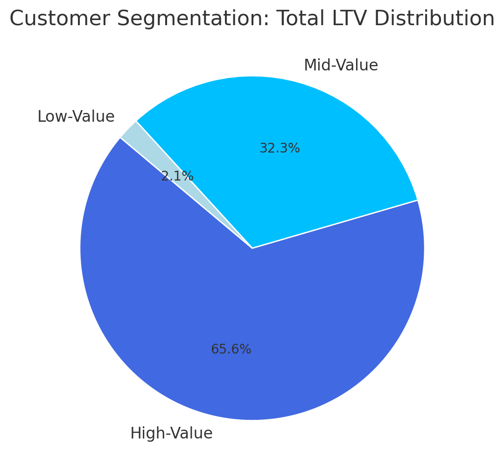
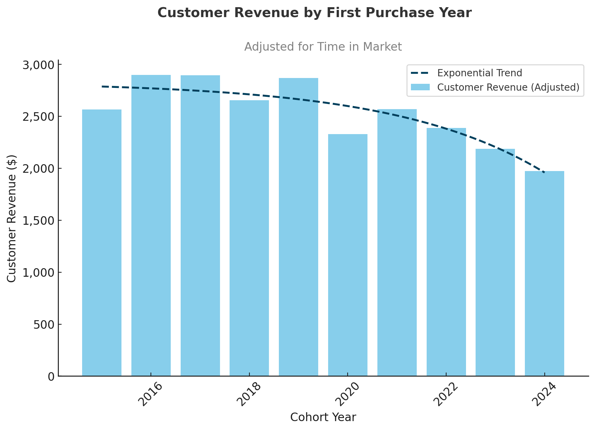
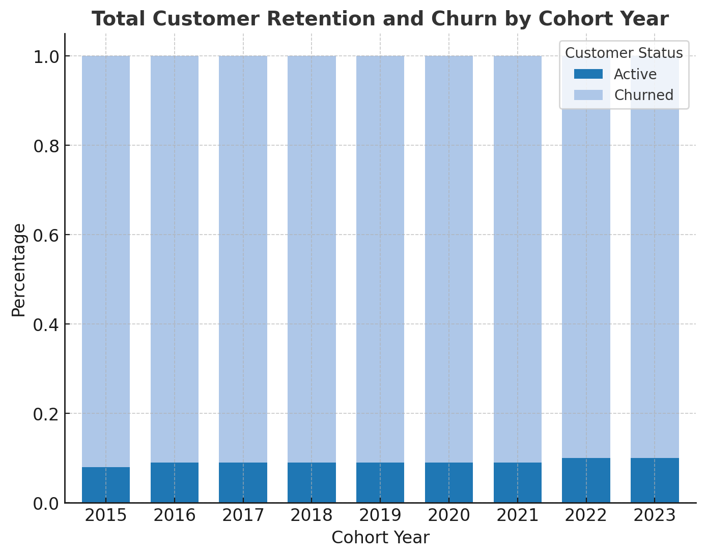

# E-Commerce Sales Analysis | PostgreSQL

**Customer Segmentation • Cohort Analysis • Customer Retention**

## Project Overview

This SQL portfolio project explores customer purchasing behavior in an e-commerce sales dataset. Using PostgreSQL, I prepared a reusable customer-level sales view, segmented customers by historical revenue, compared first-purchase revenue across acquisition-year cohorts, and classified customers as active or churned using a six-month inactivity threshold.

**Goal:** Translate transactional data into actionable insights for customer value, acquisition, and retention strategies.

## Business Questions

1. Which customer segments contribute the most revenue?
2. How do first-purchase revenue and customer counts differ by acquisition cohort?
3. What proportion of customers in each cohort have not purchased in the past six months?

## Tools & SQL Skills

- **Database:** PostgreSQL
- **SQL techniques:** CTEs, joins, aggregate functions, `CASE`, `PERCENTILE_CONT`, `ROW_NUMBER()`, `MIN() OVER`, `SUM() OVER()`, percentage-of-total calculations, date arithmetic, and views
- **Development:** DBeaver / pgAdmin
- **Visualization:** Customer segmentation, acquisition cohort, and churn charts in the `images/` folder

## Project Files

| File | Purpose |
| --- | --- |
| [`0_view_cohort_analysis.sql`](0_view_cohort_analysis.sql) | Prepare the `cohort_analysis` view from sales and customer data |
| [`1_customer_segmentation.sql`](1_customer_segmentation.sql) | Group customers using historical customer revenue quartiles and calculate each segment’s share of total revenue |
| [`2_cohort_analysis.sql`](2_cohort_analysis.sql) | Summarize revenue and customer count **on first-purchase dates** by acquisition year |
| [`3_retension_analysis.sql`](3_retension_analysis.sql) | Classify each customer by last-purchase recency and calculate cohort status percentages |

> **Filename note:** The uploaded retention script is named `3_retension_analysis.sql` (not `3_retention_analysis.sql`). Links above match the actual uploaded files.

## 1. Preparing the Data

**SQL:** [`0_view_cohort_analysis.sql`](0_view_cohort_analysis.sql)

The `cohort_analysis` view:

- Joins `sales` to `customer` using `customerkey`.
- Aggregates transactions by customer and order date.
- Calculates revenue as `SUM(quantity * netprice / exchangerate)`.
- Cleans and combines first and last names.
- Derives each customer's first purchase date and acquisition cohort year using window functions.

The view is the shared input for segmentation and cohort revenue analysis. The retention query works directly from `sales`.

## 2. Customer Segmentation

**SQL:** [`1_customer_segmentation.sql`](1_customer_segmentation.sql)

I calculated each customer's historical revenue (called **LTV** in this project), identified the 25th and 75th percentile cutoffs, and assigned customers to three segments:

- **Low-value:** below the 25th percentile
- **Mid-value:** from the 25th through the 75th percentile
- **High-value:** above the 75th percentile

The updated query reports **total revenue, customer count, average historical revenue per customer, and percentage contribution to overall revenue** for each segment.

### Revenue contribution calculation

The new `percent_contribution` column calculates each segment’s revenue as a proportion of revenue across all three segments:

```sql
SELECT
    *,
    (total_ltv / SUM(total_ltv) OVER ()) * 100 AS percent_contribution
FROM (
    -- Segment-level aggregation from 1_customer_segmentation.sql
    ...
) AS segment_summary;
```

`SUM(total_ltv) OVER ()` totals revenue across the segment-level result rows. Dividing each segment’s revenue by this overall total and multiplying by 100 produces its percentage contribution. See the linked SQL file for the complete working query.

### Results

| Customer segment | Customers | Share of customers | Historical revenue | Average revenue per customer | Revenue contribution |
| --- | ---: | ---: | ---: | ---: | ---: |
| High-value | 12,372 | ~25% | $135.61M | $10,960.80 | **65.74%** |
| Mid-value | 24,743 | ~50% | $66.37M | $2,682.29 | **32.17%** |
| Low-value | 12,372 | ~25% | $4.30M | $347.43 | **2.08%** |
| **Total** | **49,487** | **100%** | **$206.27M** | — | **~100%** |

*Figures are rounded from the query-result screenshot. Revenue is labeled USD based on the original project notes; confirm the dataset's currency convention before external financial reporting. Percentage totals may differ slightly from 100% due to rounding.*



### Key insights

- **Revenue concentration:** About one-quarter of customers generate **65.74%** of historical revenue. Retaining high-spending customers could therefore be important for protecting sales.
- **Mid-value growth opportunity:** Half of the customer base contributes **32.17%** of revenue. This group is suitable for testing targeted cross-sell and loyalty campaigns.
- **Low-value segment:** A quarter of customers accounts for only **2.08%** of revenue. Assess acquisition costs and engagement patterns before investing in broad promotions.

**Business recommendation:** Prioritize personalized retention for high-value customers, test purchase-frequency improvements for mid-value customers, and evaluate cost-effective re-engagement for low-value customers. These are proposals, not measured campaign results.

> **Metric note:** “LTV” here means cumulative **observed revenue** per customer, not predicted future customer lifetime value or customer profit. The percentile-based segment sizes are a consequence of the chosen grouping method, while their *revenue contribution percentages* are the analytical finding.

## 3. Acquisition Cohort Analysis

**SQL:** [`2_cohort_analysis.sql`](2_cohort_analysis.sql)

Customers are grouped by the **year of their first purchase**. The query returns:

- Total revenue recorded **on first-purchase dates** for each cohort
- Number of distinct customers represented
- Average first-purchase-date revenue per customer

The filter `WHERE orderdate = first_purchase_date` is important: this query **does not** calculate all future revenue generated by each cohort, nor does it produce a longitudinal retention table.

### Observations from the original README

- The original project notes suggest newer cohorts (2022–2024) show lower revenue per customer than earlier cohorts.
- A reduction in customer acquisition was reported for 2023.

These observations should be checked against saved query results before presenting them as verified numerical conclusions. Cohorts of different ages should not be compared as full lifetime-value cohorts without accounting for their different observation periods.



**Business implication:** Investigate changes in acquisition mix, first-order basket size, and promotional strategy before concluding that newly acquired customers have lower long-term value.

## 4. Customer Retention and Churn

**SQL:** [`3_retension_analysis.sql`](3_retension_analysis.sql)

For every customer, this query:

1. Determines the acquisition cohort using the year of their earliest purchase.
2. Uses `ROW_NUMBER()` to identify their most recent purchase.
3. Labels customers **Churned** when that last purchase is earlier than six months before the maximum date in the `sales` table; otherwise labels them **Active**.
4. Counts customers by cohort and status, then calculates percentages within each cohort.

### Findings reported in the original README

The original analysis notes described roughly **90% churn** and **8–10% active customers** in some older cohorts. Those reported percentages depend on the chosen inactivity definition and should be verified from the actual query results.

**Interpretation caveats:**

- This is an **inactivity-based proxy for churn**, not confirmed customer cancellation.
- The six-month cutoff is measured relative to the **latest order date in the dataset**, not today's date.
- The current query **includes customers acquired during the last six months**. As a result, newer cohorts have had less time to become inactive, making direct comparisons with older cohorts potentially misleading.



**Business implication:** Consider win-back campaigns for historically valuable inactive customers, and test engagement interventions before the six-month inactivity threshold is reached.

## Strategic Recommendations

| Priority | Recommendation | Rationale |
| --- | --- | --- |
| Protect high-value customers | Pilot VIP benefits and personalized retention offers | High-value customers account for ~65.74% of historical revenue |
| Grow mid-value relationships | Test relevant bundles, recommendations, or cross-sell campaigns | This segment represents a large share of the customer base |
| Improve acquisition quality | Monitor first-purchase revenue, cohort size, and subsequent repeat purchase | First-order results alone do not reveal full cohort LTV |
| Address inactivity | Test targeted reactivation campaigns and measure incremental return | Six-month inactivity can identify a practical outreach audience |

These are **proposed interventions**, not measured outcomes. A/B tests and cost/ROI analysis would be needed to establish impact.

## How to Run

1. Load the `sales` and `customer` tables into PostgreSQL. The source dataset is not included in this repository.
2. Run [`0_view_cohort_analysis.sql`](0_view_cohort_analysis.sql) to create the `cohort_analysis` view.
3. Run [`1_customer_segmentation.sql`](1_customer_segmentation.sql) and [`2_cohort_analysis.sql`](2_cohort_analysis.sql).
4. Run [`3_retension_analysis.sql`](3_retension_analysis.sql) for inactivity-based cohort breakdowns.

**Required source columns:** `sales` must include `customerkey`, `orderdate`, `quantity`, `netprice`, `exchangerate`, and `orderkey`; `customer` must include `customerkey`, `countryfull`, `age`, `givenname`, and `surname`.

## Possible Next Steps

- Add a proper cohort retention matrix (months since first purchase).
- Compare cohorts over identical observation windows.
- Exclude or separately flag customers acquired within the most recent six months when evaluating churn.
- Add purchase frequency, average order value, and repeat-purchase metrics.
- Export reproducible summary tables and charts to accompany findings.

## Author

**Wai Phyo Oo** — Data Analytics Portfolio  
[GitHub](https://github.com/waiphyooo12)
